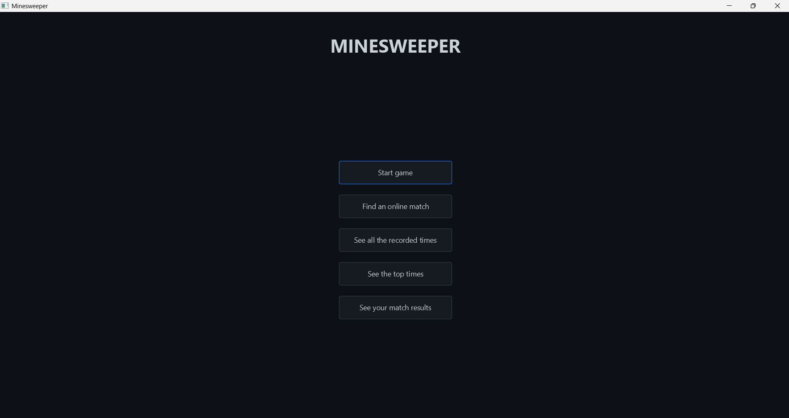
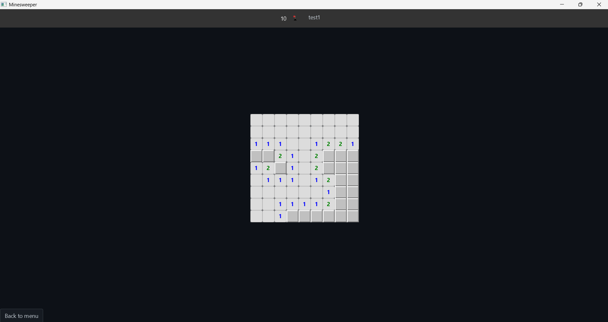
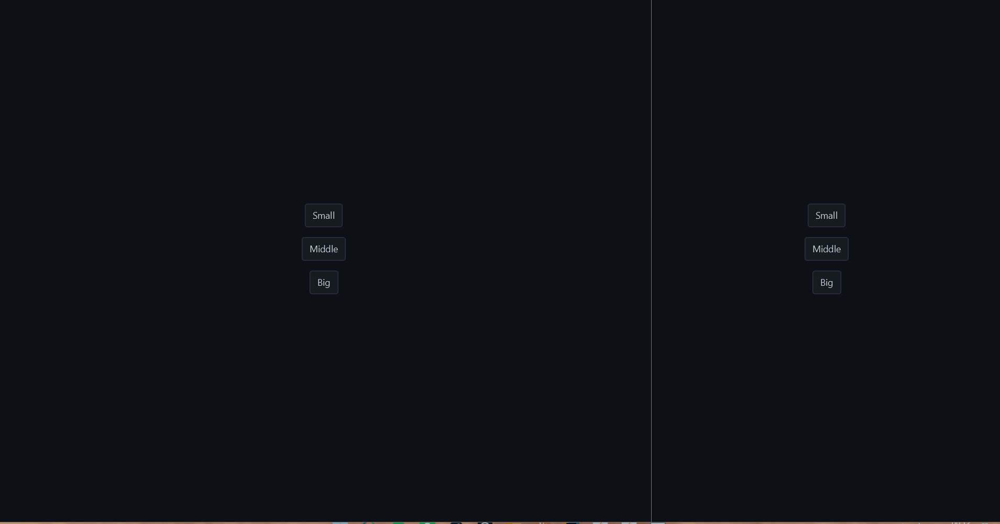

# Client-Server Minesweeper

A minesweeper app that uses client-server architecture with single-player and multiplayer game modes. Built with JavaFX, Spring Boot and MySQL.

## Screenshots of UI and Gameplay

 
*Main Menu*


*Board Screen*


*Gameplay for Online Match*

## Features

- Three difficulty choices
- Ability to see personal and top times for each difficulty
- Login and register
- Online race mode: matchmaking, same board for both players and disconnect handling
- Ability to see the total statistics for online games

## Tech Used

- Java 17
- Spring Boot
- MySQL with JdbcClient
- JavaFX
- Jackson
- BCrypt
- Maven
- AtlantaFX

## Architecture and Design Points

- Authoritative server
  - Client only sends request and draws states
- Token authentication
  - Every request is authenticated with bearer token, users cannot access other users info
- Boards are same for race game mode by creating them with the same seed
- Thread safe matchmaking
  - Doesn't let a user be stuck in a non-defined state
  - By using locks on queue and each match in order to prevent race conditions
- Scheduled cleanup of non-responsive players

## Getting Started

### Requirements
  - Java 17
  - MySQL
  - Maven

### Steps

1. Create the database
   - In MySQL, run CREATE DATABASE minesweeper;
2. Copy the server/application-local-example.properties to application-local.properties and set the database password
   - The default name for database user is root it can be changed in application-local.properties
3. Start the server
    - Run ```bash ./mvnw spring-boot:run``` in server folder
4. Start one client for singleplayer experience
    - Run ```bash mvn javafx:run```in client folder
5. Create two clients for trying multiplayer experience

## Credits

- [AtlantaFX](https://github.com/mkpaz/atlantafx) by mkpaz - UI Theme - MIT License
- [OpenJFX](https://openjfx.io) Desktop Client UI - GPL v2 with Classpath Exception
- [Spring Boot](https://spring.io/projects/spring-boot) Rest API Server - Apache 2.0
- [Jackson](https://github.com/FasterXML/jackson) JSON Serialization - Apache 2.0
- [jBCrypt](https://www.mindrot.org/projects/jBCrypt/) Password Hashing - ISC
- [MySQL Connector/J](https://dev.mysql.com/doc/connector-j/en/) Database Driver - GPL v2 with Universal FOSS Exception

## Roadmap

### Possible Improvements

- Better matchmaking system with rank system
- Using WebSockets instead of polling
- Inviting a specific friend to match
- Match history

### Next Features

- Hosting the server online
- Countdown before each match start
- Installers for major OS's
- Fixing the UI of EndGameScene
  - Having two different scenes for games and matches